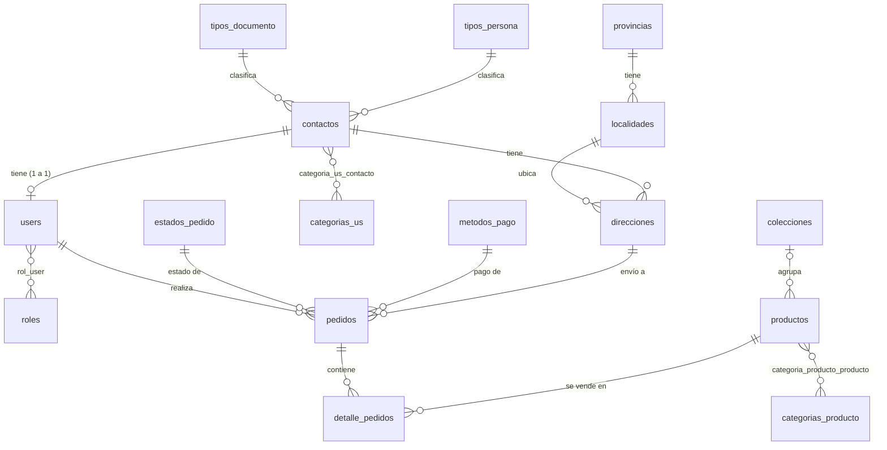

# AURA CLOTHES — E-commerce

Tienda online de indumentaria. Proyecto grupal desarrollado con **Laravel 12** y **MySQL**.

- **Frontend:** vistas Blade con HTML/CSS (carpeta `resources/views` y `public/`).
- **Backend:** controladores, modelos Eloquent, servicios de negocio y base de datos relacional (este documento).

## Requisitos

| Herramienta | Versión | Nota |
|---|---|---|
| PHP | 8.2 o superior | Con las extensiones habituales de Laravel (`pdo_mysql`, `mbstring`, `openssl`, `ctype`, `json`, `fileinfo`). XAMPP y Laragon ya las traen. |
| Composer | 2.x | Gestor de dependencias de PHP. |
| MySQL | 8.0.16 o superior | Necesario para que se apliquen las reglas `CHECK` de la base. |
| Git | cualquiera | |

Node.js **no** es necesario por ahora: las vistas usan los CSS de `public/` y no pasan por Vite.

## Instalación (primera vez)

1. Clonar el repositorio, entrar a la carpeta y pararse en la rama `develop`:

   ```bash
   git clone <URL-DEL-REPOSITORIO>
   cd auraclothes
   git checkout develop
   ```

2. Instalar las dependencias de PHP:

   ```bash
   composer install
   ```

3. Crear el archivo de configuración local. El `.env` **no se sube a Git**: cada integrante tiene el suyo.

   ```bash
   # Windows (CMD o PowerShell)
   copy .env.example .env

   # Linux / macOS
   cp .env.example .env
   ```

4. Generar la clave de la aplicación:

   ```bash
   php artisan key:generate
   ```

5. Crear las bases de datos vacías en MySQL (desde MySQL Workbench, phpMyAdmin o la consola). La segunda es solo para los tests automáticos:

   ```sql
   CREATE DATABASE ecommerce CHARACTER SET utf8mb4 COLLATE utf8mb4_unicode_ci;
   CREATE DATABASE ecommerce_test CHARACTER SET utf8mb4 COLLATE utf8mb4_unicode_ci;
   ```

6. Abrir el `.env` y completar los datos de conexión. Si tu MySQL tiene contraseña, escribila en `DB_PASSWORD`:

   ```
   DB_CONNECTION=mysql
   DB_HOST=127.0.0.1
   DB_PORT=3306
   DB_DATABASE=ecommerce
   DB_USERNAME=root
   DB_PASSWORD=
   ```

   Las líneas no deben empezar con `#`. Si `DB_CONNECTION` dice `sqlite`, cambiarlo a `mysql`. Los tests usan la base `ecommerce_test` (definida en `phpunit.xml`) con el mismo usuario y contraseña del `.env`.

7. Crear las tablas y cargar los datos de ejemplo:

   ```bash
   php artisan migrate:fresh --seed
   ```

8. Levantar el servidor de desarrollo:

   ```bash
   php artisan serve
   ```

   La aplicación queda en <http://127.0.0.1:8000>. Se detiene con `Ctrl + C`.

> **Atención:** `migrate:fresh` **borra todas las tablas** y las vuelve a crear. Usarlo solo en desarrollo.

## Usuario de prueba

El seeder crea un cliente de ejemplo (solo para desarrollo):

| Campo | Valor |
|---|---|
| Usuario (`name`) | `juanperez` |
| Correo | `juan@mail.com` |
| Contraseña | `12345678` |
| Rol | Cliente |

## Base de datos

### Diagrama de relaciones



El diagrama completo con todas las columnas está en el DER de draw.io del equipo.

### Tablas

| Grupo | Tablas |
|---|---|
| Geografía y catálogos de identidad | `provincias`, `localidades`, `tipos_documento`, `tipos_persona` |
| Personas | `contactos`, `direcciones`, `categorias_us`, `categoria_us_contacto` |
| Usuarios y permisos | `users`, `roles`, `rol_user` |
| Catálogo de productos | `colecciones`, `categorias_producto`, `productos`, `categoria_producto_producto` |
| Ventas | `estados_pedido`, `metodos_pago`, `pedidos`, `detalle_pedidos` |

Laravel además crea sus propias tablas (`sessions`, `cache`, `jobs`, `migrations`, etc.).

### Convenciones del proyecto

- **Claves foráneas:** `nombre_en_singular_id` (por ejemplo `provincia_id`, `producto_id`). Con ese nombre Laravel resuelve las relaciones solo.
- **Tablas intermedias (muchos a muchos):** los dos nombres en singular, en orden alfabético (`rol_user`). La excepción es `categoria_us_contacto`, cuyas columnas se indican a mano en el modelo.
- **Modelos:** están en `app/Models`. Donde el nombre de la tabla no sigue el plural en inglés, el modelo declara `protected $table`. Por ejemplo, `Localidad` usa la tabla `localidades`.
- **Asignación masiva:** cada modelo declara sus columnas permitidas en `$fillable`. Si se intenta guardar una columna que no está, en desarrollo Laravel lanza un error en vez de ignorarla. Al agregar una columna nueva hay que sumarla al `$fillable` del modelo.
- **Usuarios:** se reutiliza la tabla `users` de Laravel. `name` es el nombre de usuario y la contraseña va en `password` (Laravel la encripta sola). Cada usuario tiene **un** contacto (`contacto_id`, obligatorio y único), así que al registrar una persona se crea primero el `Contacto` y después el `User`, dentro de una transacción.
- **Precios:** `precio` es el precio normal. Si el producto está en oferta, `precio_oferta` guarda el precio final (nunca mayor a `precio`). El porcentaje de descuento se calcula, no se guarda. En el modelo `Producto`, `$producto->precio_final` devuelve el precio de oferta si existe, y si no el normal; `$producto->porcentaje_descuento` devuelve el porcentaje redondeado.
- **Pedidos:** no tienen una columna con el total. Se calcula con `$pedido->total()` (subtotal − descuento + costo de envío). El detalle guarda el `precio_unitario` vigente el día de la compra, así los pedidos viejos no cambian si el precio del producto cambia después.
- **Zona horaria:** `America/Argentina/Buenos_Aires` (en `config/app.php`).
- **Reglas en la base (`CHECK`):** precios y costos no negativos, cantidades mayores a cero, CUIT de 11 dígitos y oferta menor o igual al precio.

### Scopes disponibles

Atajos para consultas frecuentes:

| Modelo | Scope | Qué filtra |
|---|---|---|
| `Producto` | `activos()` | Productos publicados (`activo = true`) |
| `Producto` | `enOferta()` | Con `precio_oferta` cargado |
| `Producto` | `conStock()` | Con stock mayor a cero |
| `Producto` | `deColeccion($id)` | De una colección |
| `Producto` | `deCategoria($id)` | De una categoría |
| `Pedido` | `delUsuario($id)` | Pedidos de un usuario |
| `User` | `activos()` | Usuarios habilitados |

Se pueden encadenar: `Producto::activos()->enOferta()->conStock()->get()`.

### Seeders

Se ejecutan en este orden desde `DatabaseSeeder`:

1. `CatalogosSeeder`: tipos de documento y de persona, estados de pedido, métodos de pago, roles, provincias, localidades de Misiones, colecciones y categorías.
2. `ProductosSeeder`: los productos que se muestran en el frontend.
3. `DatosDemoSeeder`: un contacto con dirección, su usuario, y un pedido de ejemplo.

> El pedido de ejemplo de `DatosDemoSeeder` se crea a mano y **no descuenta stock**. No cancelarlo para probar la devolución de stock; para eso crear un pedido nuevo con `PedidoService`.

### Ejemplos de consultas

```php
// Pedido con sus productos y el total
$pedido = Pedido::with('detalles.producto')->find(1);
$pedido->subtotal();
$pedido->total();

// Productos en oferta y con stock
Producto::activos()->enOferta()->conStock()->get();

// Productos con su colección y categorías
Producto::with(['coleccion', 'categorias'])->activos()->get();
```

Para probar consultas a mano: `php artisan tinker`.

## Lógica de pedidos (`PedidoService`)

Toda la creación y los cambios de estado de pedidos pasan por `app/Services/PedidoService.php`. **No se debe crear un `Pedido` ni tocar el stock directamente** desde controladores: así se garantiza que el stock y el precio queden siempre consistentes.

### Crear un pedido

```php
use App\Services\PedidoService;

$pedido = app(PedidoService::class)->crear(
    user: $user,
    items: [
        ['producto_id' => 1, 'cantidad' => 2],
        ['producto_id' => 4, 'cantidad' => 1],
    ],
    direccionId: $direccion->id,
    metodoPagoId: $metodoPago->id,
    costoEnvio: 1500,   // opcional, por defecto 0
    descuento: 0,       // opcional, por defecto 0
);
```

Todo ocurre dentro de una transacción: o se guarda el pedido completo, o no se guarda nada. El servicio:

- Valida que la dirección pertenezca al usuario y que el método de pago exista.
- Bloquea los productos mientras se procesa, para que dos compras simultáneas no vendan el mismo último producto.
- Verifica que cada producto esté activo y que haya stock.
- Guarda en el detalle el `precio_final` vigente (precio de oferta si existe).
- Descuenta el stock.
- Si el mismo producto viene repetido, suma las cantidades en una sola línea.
- El pedido nace en estado **Pendiente**.

### Estados y transiciones

| Desde | Puede pasar a |
|---|---|
| Pendiente | Pagado, Cancelado |
| Pagado | En preparación, Cancelado |
| En preparación | Enviado, Cancelado |
| Enviado | Entregado |
| Entregado | *(estado final)* |
| Cancelado | *(estado final)* |

```php
$servicio = app(PedidoService::class);

$servicio->cambiarEstado($pedido, EstadoPedido::PAGADO);
$servicio->cancelar($pedido);   // devuelve el stock de los productos
```

Los nombres de los estados están como constantes en `EstadoPedido` (`PENDIENTE`, `PAGADO`, `EN_PREPARACION`, `ENVIADO`, `ENTREGADO`, `CANCELADO`) y el mapa de transiciones en `EstadoPedido::TRANSICIONES`. Un cambio no permitido (por ejemplo, de Cancelado a Enviado) lanza una excepción, y cancelar dos veces no devuelve el stock dos veces.

### Errores

Cuando algo no es válido (sin stock, dirección ajena, transición prohibida), el servicio lanza `App\Exceptions\PedidoInvalidoException` con un mensaje legible. Los controladores deben atraparla y mostrar el mensaje al usuario:

```php
try {
    $pedido = $servicio->crear(...);
} catch (PedidoInvalidoException $e) {
    return back()->withErrors(['pedido' => $e->getMessage()]);
}
```

## Tests automáticos

Los tests están en `tests/Feature` y usan la base `ecommerce_test` (se borra y recrea en cada corrida, por eso no toca los datos de `ecommerce`).

```bash
php artisan test                            # todos
php artisan test --filter=PedidoServiceTest # solo los de pedidos
```

`PedidoServiceTest` cubre: creación con precio de oferta, falta de stock sin dejar datos a medias, dirección de otro usuario, productos repetidos, cancelación con devolución de stock y transiciones inválidas.

Las *factories* (`database/factories`) fabrican datos de prueba: `Producto::factory()->create()`, `Producto::factory()->enOferta(8000)->create()`, `User::factory()->create()`, etc. Si se agrega una columna obligatoria a una tabla, hay que sumarla también a su factory.

> Antes de fusionar a `develop`, correr `php artisan test`. Si algo se rompe, es mejor enterarse antes de la fusión.

## Comandos útiles

| Comando | Qué hace |
|---|---|
| `php artisan migrate:fresh --seed` | Borra y recrea toda la base con los datos de ejemplo |
| `php artisan migrate` | Ejecuta solo las migraciones nuevas |
| `php artisan migrate:status` | Muestra qué migraciones se ejecutaron |
| `php artisan db:show` | Muestra a qué base se conecta Laravel y sus tablas |
| `php artisan tinker` | Consola para probar código con la base |
| `php artisan test` | Corre los tests automáticos |
| `php artisan config:clear` | Limpia la configuración guardada (útil después de editar el `.env`) |
| `php artisan route:list` | Lista las rutas de la aplicación |

## Trabajo en equipo

- **`develop`** es la rama de integración: tiene lo último de todo el equipo. Cada tarea se trabaja en una **rama propia** (por ejemplo `feature/registro`, `feature/carrito` o `db-creation`) y se fusiona a `develop` mediante *pull request*. No trabajar directamente sobre `main` ni sobre `develop`.
- Antes de hacer un commit, comprobar la rama con `git branch --show-current`.
- Antes de abrir un pull request: traer lo último de `develop` a la rama propia (`git merge develop`), resolver los conflictos ahí, y correr `php artisan migrate:fresh --seed` y `php artisan test`.
- **Las migraciones y los seeders los modifica una sola persona** (responsable de la base de datos). Si hace falta una columna o tabla nueva, se pide. Así no se rompe el `migrate:fresh` de nadie.
- Después de cada fusión: `git pull`, `composer install` (si cambió `composer.json`) y `php artisan migrate:fresh --seed`.
- Nunca subir el `.env` ni contraseñas reales. El `.env.example` solo lleva valores de ejemplo.
- `routes/web.php` y `app/Models/User.php` los tocan varios integrantes: avisar y hacer commits chicos y frecuentes para evitar conflictos.
- Cada ruta con nombre (`->name('productos')`) tiene que ser única, porque las vistas enlazan con `route('nombre')`.

## Solución de problemas

| Problema | Causa probable | Qué hacer |
|---|---|---|
| `php artisan migrate` dice `Nothing to migrate`, pero Workbench no muestra tablas | Falta el `.env` o dice `DB_CONNECTION=sqlite` | Copiar `.env.example` a `.env`, corregir la conexión y correr `php artisan config:clear` |
| `Access denied for user` / `Unknown database 'ecommerce'` | Datos del `.env` incorrectos, o la base no existe | Revisar usuario, contraseña y puerto; crear la base `ecommerce` |
| `Unknown database 'ecommerce_test'` al correr los tests | Falta la base de pruebas | Crear la base `ecommerce_test` (paso 5 de la instalación) |
| `Can't connect to MySQL server` | MySQL apagado | Iniciar MySQL (en XAMPP, botón *Start* del módulo MySQL) |
| `Table '...' already exists` después de una migración fallida | MySQL no deshace las tablas ya creadas | `php artisan migrate:fresh --seed` |
| `No application encryption key has been specified` | Falta la clave | `php artisan key:generate` |
| `Unknown or bad timezone` | Zona horaria escrita con `\` | Usar barras comunes: `America/Argentina/Buenos_Aires` |
| `Class "App\Models\..." not found` | Archivo faltante o mal nombrado | Revisar el nombre del archivo y el `namespace`; probar `composer dump-autoload` |
| Error `Unknown column ...` al sembrar | El seeder usa un nombre de columna distinto al de la migración | Comparar el nombre de la columna en la migración con el del seeder |
| `Add [campo] to fillable property` | Se intentó guardar una columna que no está en `$fillable` | Agregar la columna al `$fillable` del modelo |
| `Route [nombre] not defined` | Una vista usa `route('nombre')` y la ruta no tiene ese nombre | Agregar `->name('nombre')` en `routes/web.php` |
| Los tests fallan con `foreign key constraint fails` | Una factory usa un id fijo (por ejemplo `1`) de un catálogo | Obtener el id con `Modelo::query()->value('id')` |
| Los errores `Undefined class constant` aparecen en VS Code pero el código anda | Caché de Intelephense | `Ctrl + Shift + P` → *Intelephense: Index workspace* |

## Estado del proyecto

**Hecho**

- Base de datos: migraciones, modelos con relaciones, reglas de integridad y seeders.
- Modelos reforzados: `$fillable`, conversiones de tipos, scopes y precio final calculado.
- Creación de pedidos con control de stock y precio vigente (`PedidoService::crear`).
- Estados del pedido con transiciones válidas y cancelación con devolución de stock.
- Factories y tests automáticos de la lógica de pedidos.
- Vistas estáticas del sitio y listado de productos desde el controlador.

**En curso / pendiente**

- Registro de usuarios (creación de contacto + usuario en una transacción).
- Normalizar la regla de dirección principal (una sola `es_principal` por contacto).
- Filtros de productos (colección, categoría, oferta, búsqueda).
- Carrito de compras (sesión).
- Inicio y cierre de sesión, y permisos por rol.
- Controladores y validaciones del checkout, y conexión de las vistas con la base.
- Panel de administración.
- Pendientes de frontend: que `productos.blade.php` muestre los datos reales, y el archivo `public/js/productos.js` que la vista referencia.
