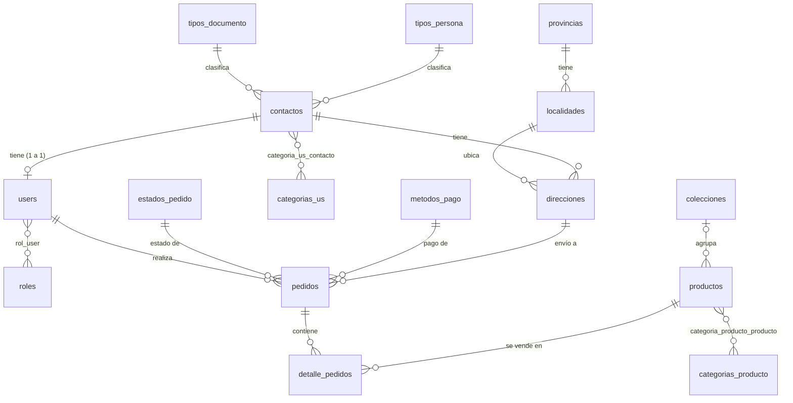

# AURA CLOTHES — E-commerce

Tienda online de indumentaria. Proyecto grupal desarrollado con **Laravel 12** y **MySQL**.

- **Frontend:** vistas Blade con HTML/CSS (carpeta `resources/views` y `public/`).
- **Backend:** controladores, modelos Eloquent y base de datos relacional (este documento).

## Requisitos

| Herramienta | Versión | Nota |
|---|---|---|
| PHP | 8.2 o superior | Con las extensiones habituales de Laravel (`pdo_mysql`, `mbstring`, `openssl`, `ctype`, `json`, `fileinfo`). XAMPP y Laragon ya las traen. |
| Composer | 2.x | Gestor de dependencias de PHP. |
| MySQL | 8.0.16 o superior | Necesario para que se apliquen las reglas `CHECK` de la base. |
| Git | cualquiera | |

Node.js **no** es necesario por ahora: las vistas usan los CSS de `public/` y no pasan por Vite.

## Instalación (primera vez)

1. Clonar el repositorio y entrar a la carpeta:

   ```bash
   git clone <URL-DEL-REPOSITORIO>
   cd auraclothes
   ```

2. Instalar las dependencias de PHP:

   ```bash
   composer install
   ```

3. Crear el archivo de configuración local. El `.env` **no se sube a Git**: cada integrante tiene el suyo.

   ```bash
   # Windows (CMD o PowerShell)
   copy .env.example .env

   # Linux / macOS
   cp .env.example .env
   ```

4. Generar la clave de la aplicación:

   ```bash
   php artisan key:generate
   ```

5. Crear la base de datos vacía en MySQL (desde MySQL Workbench, phpMyAdmin o la consola):

   ```sql
   CREATE DATABASE ecommerce CHARACTER SET utf8mb4 COLLATE utf8mb4_unicode_ci;
   ```

6. Abrir el `.env` y completar los datos de conexión. Si tu MySQL tiene contraseña, escribila en `DB_PASSWORD`:

   ```
   DB_CONNECTION=mysql
   DB_HOST=127.0.0.1
   DB_PORT=3306
   DB_DATABASE=ecommerce
   DB_USERNAME=root
   DB_PASSWORD=
   ```

   Las líneas no deben empezar con `#`. Si `DB_CONNECTION` dice `sqlite`, cambiarlo a `mysql`.

7. Crear las tablas y cargar los datos de ejemplo:

   ```bash
   php artisan migrate:fresh --seed
   ```

8. Levantar el servidor de desarrollo:

   ```bash
   php artisan serve
   ```

   La aplicación queda en <http://127.0.0.1:8000>. Se detiene con `Ctrl + C`.

> **Atención:** `migrate:fresh` **borra todas las tablas** y las vuelve a crear. Usarlo solo en desarrollo.

## Usuario de prueba

El seeder crea un cliente de ejemplo (solo para desarrollo):

| Campo | Valor |
|---|---|
| Usuario (`name`) | `juanperez` |
| Correo | `juan@mail.com` |
| Contraseña | `12345678` |
| Rol | Cliente |

## Base de datos

### Diagrama de relaciones



El diagrama completo con todas las columnas está en el DER de draw.io del equipo.

### Tablas

| Grupo | Tablas |
|---|---|
| Geografía y catálogos de identidad | `provincias`, `localidades`, `tipos_documento`, `tipos_persona` |
| Personas | `contactos`, `direcciones`, `categorias_us`, `categoria_us_contacto` |
| Usuarios y permisos | `users`, `roles`, `rol_user` |
| Catálogo de productos | `colecciones`, `categorias_producto`, `productos`, `categoria_producto_producto` |
| Ventas | `estados_pedido`, `metodos_pago`, `pedidos`, `detalle_pedidos` |

Laravel además crea sus propias tablas (`sessions`, `cache`, `jobs`, `migrations`, etc.).

### Convenciones del proyecto

- **Claves foráneas:** `nombre_en_singular_id` (por ejemplo `provincia_id`, `producto_id`). Con ese nombre Laravel resuelve las relaciones solo.
- **Tablas intermedias (muchos a muchos):** los dos nombres en singular, en orden alfabético (`rol_user`). La excepción es `categoria_us_contacto`, cuyas columnas se indican a mano en el modelo.
- **Modelos:** están en `app/Models`. Donde el nombre de la tabla no sigue el plural en inglés, el modelo declara `protected $table`. Por ejemplo, `Localidad` usa la tabla `localidades`.
- **Usuarios:** se reutiliza la tabla `users` de Laravel. `name` es el nombre de usuario y la contraseña va en `password` (Laravel la encripta sola). Cada usuario tiene **un** contacto (`contacto_id`, obligatorio y único), así que al registrar una persona se crea primero el `Contacto` y después el `User`, dentro de una transacción.
- **Precios:** `precio` es el precio normal. Si el producto está en oferta, `precio_oferta` guarda el precio final (nunca mayor a `precio`). El porcentaje de descuento se calcula, no se guarda.
- **Pedidos:** no tienen una columna con el total. Se calcula con `$pedido->total()`. El detalle guarda el `precio_unitario` vigente el día de la compra, así los pedidos viejos no cambian si el precio del producto cambia después.
- **Zona horaria:** `America/Argentina/Buenos_Aires` (en `config/app.php`).
- **Reglas en la base (`CHECK`):** precios y costos no negativos, cantidades mayores a cero, CUIT de 11 dígitos y oferta menor o igual al precio.

### Seeders

Se ejecutan en este orden desde `DatabaseSeeder`:

1. `CatalogosSeeder`: tipos de documento y de persona, estados de pedido, métodos de pago, roles, provincias, localidades de Misiones, colecciones y categorías.
2. `ProductosSeeder`: los productos que se muestran en el frontend.
3. `DatosDemoSeeder`: un contacto con dirección, su usuario, y un pedido de ejemplo.

### Ejemplos de consultas

```php
// Pedido con sus productos y el total
$pedido = Pedido::with('detalles.producto')->find(1);
$pedido->subtotal();
$pedido->total();

// Productos en oferta
Producto::whereNotNull('precio_oferta')->get();

// Productos con su colección y categorías
Producto::with(['coleccion', 'categorias'])->where('activo', true)->get();
```

Para probar consultas a mano: `php artisan tinker`.

## Comandos útiles

| Comando | Qué hace |
|---|---|
| `php artisan migrate:fresh --seed` | Borra y recrea toda la base con los datos de ejemplo |
| `php artisan migrate` | Ejecuta solo las migraciones nuevas |
| `php artisan migrate:status` | Muestra qué migraciones se ejecutaron |
| `php artisan db:show` | Muestra a qué base se conecta Laravel y sus tablas |
| `php artisan tinker` | Consola para probar código con la base |
| `php artisan config:clear` | Limpia la configuración guardada (útil después de editar el `.env`) |
| `php artisan route:list` | Lista las rutas de la aplicación |

## Trabajo en equipo

- Una **rama por funcionalidad** (`feature/registro`, `feature/carrito`, etc.) y fusionar mediante *pull request*. No trabajar directamente sobre `main`.
- **Las migraciones y los seeders los modifica una sola persona** (responsable de la base de datos). Si hace falta una columna o tabla nueva, se pide. Así no se rompe el `migrate:fresh` de nadie.
- Después de cada fusión: `git pull`, `composer install` (si cambió `composer.json`) y `php artisan migrate:fresh --seed`.
- Nunca subir el `.env` ni contraseñas reales. El `.env.example` solo lleva valores de ejemplo.
- `routes/web.php` y `app/Models/User.php` los tocan varios integrantes: avisar y hacer commits chicos y frecuentes para evitar conflictos.

## Solución de problemas

| Problema | Causa probable | Qué hacer |
|---|---|---|
| `php artisan migrate` dice `Nothing to migrate`, pero Workbench no muestra tablas | Falta el `.env` o dice `DB_CONNECTION=sqlite` | Copiar `.env.example` a `.env`, corregir la conexión y correr `php artisan config:clear` |
| `Access denied for user` / `Unknown database 'ecommerce'` | Datos del `.env` incorrectos, o la base no existe | Revisar usuario, contraseña y puerto; crear la base `ecommerce` |
| `Can't connect to MySQL server` | MySQL apagado | Iniciar MySQL (en XAMPP, botón *Start* del módulo MySQL) |
| `Table '...' already exists` después de una migración fallida | MySQL no deshace las tablas ya creadas | `php artisan migrate:fresh --seed` |
| `No application encryption key has been specified` | Falta la clave | `php artisan key:generate` |
| `Unknown or bad timezone` | Zona horaria escrita con `\` | Usar barras comunes: `America/Argentina/Buenos_Aires` |
| `Class "App\Models\..." not found` | Archivo faltante o mal nombrado | Revisar el nombre del archivo y el `namespace`; probar `composer dump-autoload` |
| Error `Unknown column ...` al sembrar | El seeder usa un nombre de columna distinto al de la migración | Comparar el nombre de la columna en la migración con el del seeder |

## Estado del proyecto

- **Hecho:** base de datos (migraciones, modelos con relaciones, reglas de integridad y seeders) y las vistas estáticas del sitio.
- **En curso / pendiente:** conectar el catálogo a la base, registro e inicio de sesión, carrito, creación de pedidos y panel de administración.
