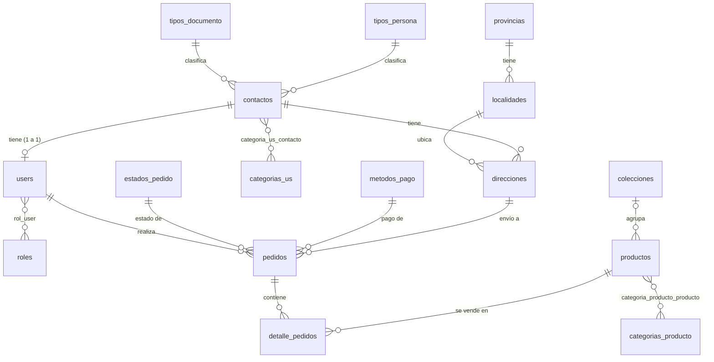

# AURA CLOTHES — E-commerce

Tienda online de indumentaria. Proyecto grupal desarrollado con **Laravel 12** y **MySQL**.

- **Frontend:** vistas Blade con HTML/CSS (carpeta `resources/views` y `public/`).
- **Backend:** controladores, modelos Eloquent, servicios de negocio y base de datos relacional (este documento).

## Índice

1. [Requisitos](#requisitos)
2. [Instalación (primera vez)](#instalación-primera-vez)
3. [Usuarios de prueba](#usuarios-de-prueba)
4. [Base de datos](#base-de-datos)
5. [Servicios de negocio](#servicios-de-negocio)
6. [Rutas](#rutas)
7. [Permisos](#permisos)
8. [Validaciones e idioma](#validaciones-e-idioma)
9. [Guía para conectar las vistas](#guía-para-conectar-las-vistas)
10. [Tests automáticos](#tests-automáticos)
11. [Comandos útiles](#comandos-útiles)
12. [Trabajo en equipo](#trabajo-en-equipo)
13. [Solución de problemas](#solución-de-problemas)
14. [Estado del proyecto](#estado-del-proyecto)

## Requisitos

| Herramienta | Versión | Nota |
|---|---|---|
| PHP | 8.2 o superior | Con las extensiones habituales de Laravel (`pdo_mysql`, `mbstring`, `openssl`, `ctype`, `json`, `fileinfo`). XAMPP y Laragon ya las traen. |
| Composer | 2.x | Gestor de dependencias de PHP. |
| MySQL | 8.0.16 o superior | Necesario para que se apliquen las reglas `CHECK` de la base. |
| Git | cualquiera | |

Node.js **no** es necesario por ahora: las vistas usan los CSS de `public/` y no pasan por Vite.

## Instalación (primera vez)

1. Clonar el repositorio, entrar a la carpeta y pararse en la rama `develop`:

   ```bash
   git clone https://github.com/mavancal/auraclothes.git
   cd auraclothes
   git checkout develop
   ```

2. Instalar las dependencias de PHP:

   ```bash
   composer install
   ```

3. Crear el archivo de configuración local. El `.env` **no se sube a Git**: cada integrante tiene el suyo.

   ```bash
   # Windows (CMD o PowerShell)
   copy .env.example .env

   # Linux / macOS
   cp .env.example .env
   ```

4. Generar la clave de la aplicación:

   ```bash
   php artisan key:generate
   ```

5. Crear las bases de datos vacías en MySQL (desde MySQL Workbench, phpMyAdmin o la consola). La segunda es solo para los tests automáticos:

   ```sql
   CREATE DATABASE ecommerce CHARACTER SET utf8mb4 COLLATE utf8mb4_unicode_ci;
   CREATE DATABASE ecommerce_test CHARACTER SET utf8mb4 COLLATE utf8mb4_unicode_ci;
   ```

6. Abrir el `.env` y completar los datos de conexión. Si tu MySQL tiene contraseña, escribila en `DB_PASSWORD`:

   ```
   DB_CONNECTION=mysql
   DB_HOST=127.0.0.1
   DB_PORT=3306
   DB_DATABASE=ecommerce
   DB_USERNAME=root
   DB_PASSWORD=
   ```

   Las líneas no deben empezar con `#`. Si `DB_CONNECTION` dice `sqlite`, cambiarlo a `mysql`. Los tests usan la base `ecommerce_test` (definida en `phpunit.xml`) con el mismo usuario y contraseña del `.env`.

   En el mismo `.env`, revisar que el idioma esté en español (ya viene así en `.env.example`):

   ```
   APP_LOCALE=es
   APP_FALLBACK_LOCALE=en
   APP_FAKER_LOCALE=es_AR
   ```

7. Crear las tablas y cargar los datos de ejemplo:

   ```bash
   php artisan migrate:fresh --seed
   ```

8. Levantar el servidor de desarrollo:

   ```bash
   php artisan serve
   ```

   La aplicación queda en <http://127.0.0.1:8000>. Se detiene con `Ctrl + C`.

> **Atención:** `migrate:fresh` **borra todas las tablas** y las vuelve a crear. Usarlo solo en desarrollo.

## Usuarios de prueba

El seeder crea estos usuarios (**solo para desarrollo**, no deben existir en un servidor real):

| Rol | Usuario (`name`) | Correo | Contraseña | Puede |
|---|---|---|---|---|
| Cliente | `juanperez` | `juan@mail.com` | `12345678` | Comprar, ver y cancelar sus pedidos |
| Administrador | `admin` | `admin@auraclothes.com` | `admin1234` | Todo lo anterior + panel de productos y de pedidos |

Juan Pérez tiene una dirección en Posadas y un pedido de ejemplo (creado con `PedidoService`, así que ya descontó stock).

## Base de datos

### Diagrama de relaciones



El diagrama completo con todas las columnas está en `docs/DER.png` (generado desde la base; su código Mermaid está en `docs/DER.mmd`). La estructura en SQL está en `docs/ecommerce_estructura.sql` y, con los datos de ejemplo, en `docs/ecommerce_con_datos.sql`.

### Tablas

| Grupo | Tablas |
|---|---|
| Geografía y catálogos de identidad | `provincias`, `localidades`, `tipos_documento`, `tipos_persona` |
| Personas | `contactos`, `direcciones`, `categorias_us`, `categoria_us_contacto` |
| Usuarios y permisos | `users`, `roles`, `rol_user` |
| Catálogo de productos | `colecciones`, `categorias_producto`, `productos`, `categoria_producto_producto` |
| Ventas | `estados_pedido`, `metodos_pago`, `pedidos`, `detalle_pedidos` |

Laravel además crea sus propias tablas (`sessions`, `cache`, `jobs`, `migrations`, etc.).

### Convenciones del proyecto

- **Claves foráneas:** `nombre_en_singular_id` (por ejemplo `provincia_id`, `producto_id`). Con ese nombre Laravel resuelve las relaciones solo.
- **Tablas intermedias (muchos a muchos):** los dos nombres en singular, en orden alfabético (`rol_user`). La excepción es `categoria_us_contacto`, cuyas columnas se indican a mano en el modelo.
- **Modelos:** están en `app/Models`. Donde el nombre de la tabla no sigue el plural en inglés, el modelo declara `protected $table`. Por ejemplo, `Localidad` usa la tabla `localidades`.
- **Asignación masiva:** cada modelo declara sus columnas permitidas en `$fillable`. Si se intenta guardar una columna que no está, en desarrollo Laravel lanza un error en vez de ignorarla. Al agregar una columna nueva hay que sumarla al `$fillable` del modelo.
- **Usuarios:** se reutiliza la tabla `users` de Laravel. `name` es el nombre de usuario y la contraseña va en `password` (Laravel la encripta sola: **no** hay que usar `Hash::make` antes de guardarla). Cada usuario tiene **un** contacto (`contacto_id`, obligatorio y único), por eso el registro pasa por `RegistroService`.
- **Direcciones:** cada contacto tiene **una sola** dirección principal (`es_principal`). La regla la mantiene `DireccionService`.
- **Precios:** `precio` es el precio normal. Si el producto está en oferta, `precio_oferta` guarda el precio final (nunca mayor a `precio`). El porcentaje de descuento se calcula, no se guarda. En el modelo `Producto`, `$producto->precio_final` devuelve el precio de oferta si existe, y si no el normal; `$producto->porcentaje_descuento` devuelve el porcentaje redondeado.
- **Pedidos:** no tienen una columna con el total. Se calcula con `$pedido->total()` (subtotal − descuento + costo de envío). El detalle guarda el `precio_unitario` vigente el día de la compra, así los pedidos viejos no cambian si el precio del producto cambia después.
- **Zona horaria:** `America/Argentina/Buenos_Aires` (en `config/app.php`).
- **Reglas en la base (`CHECK`):** precios y costos no negativos, cantidades mayores a cero, CUIT de 11 dígitos y oferta menor o igual al precio.

### Scopes disponibles

Atajos para consultas frecuentes:

| Modelo | Scope | Qué filtra |
|---|---|---|
| `Producto` | `activos()` | Productos publicados (`activo = true`) |
| `Producto` | `enOferta()` | Con `precio_oferta` cargado |
| `Producto` | `conStock()` | Con stock mayor a cero |
| `Producto` | `deColeccion($id)` | De una colección |
| `Producto` | `deCategoria($id)` | De una categoría |
| `Pedido` | `delUsuario($id)` | Pedidos de un usuario |
| `User` | `activos()` | Usuarios habilitados |

Se pueden encadenar: `Producto::activos()->enOferta()->conStock()->get()`.

### Seeders

Se ejecutan en este orden desde `DatabaseSeeder`:

1. `CatalogosSeeder`: tipos de documento y de persona, estados de pedido, métodos de pago, roles, provincias, localidades de Misiones, colecciones y categorías.
2. `ProductosSeeder`: los productos que se muestran en el frontend.
3. `DatosDemoSeeder`: el cliente Juan Pérez (con dirección y un pedido de ejemplo creado con `PedidoService`) y el usuario administrador.

### Ejemplos de consultas

```php
// Pedido con sus productos y el total
$pedido = Pedido::with('detalles.producto')->find(1);
$pedido->subtotal();
$pedido->total();

// Productos en oferta y con stock
Producto::activos()->enOferta()->conStock()->get();

// Productos con su colección y categorías
Producto::with(['coleccion', 'categorias'])->activos()->get();

// Nivel de permiso de un usuario
$user->nivelPermiso();     // 10, 50 o 100
$user->tieneNivel(50);     // ¿es empleado o administrador?
```

Para probar consultas a mano: `php artisan tinker` (se sale con `exit`).

## Servicios de negocio

Las reglas del negocio viven en `app/Services`, no en los controladores. **Los controladores llaman a los servicios**; así las reglas se escriben una sola vez y se prueban con tests.

| Servicio | Para qué | Excepción que lanza |
|---|---|---|
| `RegistroService` | Alta de cliente: contacto + dirección principal + usuario + rol Cliente | `RegistroInvalidoException` |
| `DireccionService` | Agregar direcciones y elegir la principal (una sola por contacto) | `DireccionInvalidaException` |
| `CatalogoService` | Listado de productos con búsqueda, filtros, orden y páginas | *(ninguna: los filtros inválidos se ignoran)* |
| `CarritoService` | Carrito de compras guardado en la sesión | `CarritoInvalidoException` |
| `SesionService` | Iniciar y cerrar sesión | `SesionInvalidaException` |
| `PedidoService` | Crear pedidos, cambiar su estado y cancelarlos | `PedidoInvalidoException` |

Las excepciones están en `app/Exceptions` y traen un mensaje listo para mostrar al usuario. Los controladores las atrapan así:

```php
try {
    $servicio->hacerAlgo(...);
} catch (PedidoInvalidoException $e) {
    return back()->withErrors(['pedido' => $e->getMessage()]);
}
```

### `RegistroService`

```php
$user = app(RegistroService::class)->registrar($datos);
```

En una transacción: verifica que el usuario, el correo, el documento y el CUIT no estén repetidos y que la localidad exista; crea el `Contacto`, su primera `Direccion` (principal), el `User` y le asigna el rol **Cliente**. El CUIT se guarda solo con números (acepta `20-30111222-3`). Las claves de `$datos` son los mismos `name` del formulario de registro: `name`, `email`, `password`, `nombre`, `nombre2`, `apellido`, `tipo_documento_id`, `numero_documento`, `cuit`, `fecha_nacimiento`, `telefono`, `email_contacto`, `tipo_persona_id`, `calle`, `numero`, `piso`, `departamento`, `cod_postal`, `referencia`, `localidad_id`.

### `DireccionService`

```php
$servicio = app(DireccionService::class);
$servicio->agregar($user, $datos, principal: true);
$servicio->marcarComoPrincipal($user, $direccionId);
```

La primera dirección de un contacto queda principal sola. Al marcar una como principal se desmarcan las demás. No se puede marcar una dirección de otro usuario.

### `CatalogoService`

```php
$productos = app(CatalogoService::class)->buscar([
    'q'            => 'remera',      // busca en nombre, descripción y SKU
    'coleccion_id' => 2,
    'categoria_id' => 5,
    'en_oferta'    => true,
    'con_stock'    => true,
    'orden'        => 'precio_asc',  // nuevos | precio_asc | precio_desc | nombre
], porPagina: 12);
```

Siempre devuelve solo productos activos, paginados. Todos los filtros son opcionales. El orden por precio usa el **precio final** (el de oferta si existe).

### `CarritoService`

```php
$carrito = app(CarritoService::class);
$carrito->agregar($productoId, 2);      // suma si ya estaba
$carrito->actualizar($productoId, 1);   // reemplaza la cantidad (0 = quitar)
$carrito->quitar($productoId);
$carrito->vaciar();
$carrito->items();                      // [['producto' => ..., 'cantidad' => ..., 'subtotal' => ...], ...]
$carrito->subtotal();
$carrito->cantidadTotal();              // unidades, para el ícono del carrito
$carrito->paraPedido();                 // formato que espera PedidoService::crear()
```

En la sesión se guarda solo `[producto_id => cantidad]`. **El precio nunca se guarda en la sesión**: siempre se lee de la base. Controla que el producto esté activo y que haya stock, y saca del carrito los productos que se dieron de baja. **El carrito no descuenta stock**: el stock se descuenta recién al crear el pedido.

### `SesionService`

```php
app(SesionService::class)->iniciar($email, $password, recordar: false);
app(SesionService::class)->cerrar();
```

El login es con **correo y contraseña**. Si el correo no existe o la contraseña es incorrecta, el mensaje es el mismo ("Correo o contraseña incorrectos."), para no revelar qué correos están registrados. Un usuario con `activo = false` no puede entrar. Cada inicio de sesión actualiza `ultimo_acceso`.

### `PedidoService`

Toda la creación y los cambios de estado de pedidos pasan por `app/Services/PedidoService.php`. **No se debe crear un `Pedido` ni tocar el stock directamente** desde controladores: así se garantiza que el stock y el precio queden siempre consistentes.

#### Crear un pedido

```php
use App\Services\PedidoService;

$pedido = app(PedidoService::class)->crear(
    user: $user,
    items: [
        ['producto_id' => 1, 'cantidad' => 2],
        ['producto_id' => 4, 'cantidad' => 1],
    ],
    direccionId: $direccion->id,
    metodoPagoId: $metodoPago->id,
    costoEnvio: 1500,   // opcional, por defecto 0
    descuento: 0,       // opcional, por defecto 0
);
```

Todo ocurre dentro de una transacción: o se guarda el pedido completo, o no se guarda nada. El servicio:

- Valida que la dirección pertenezca al usuario y que el método de pago exista.
- Bloquea los productos mientras se procesa, para que dos compras simultáneas no vendan el mismo último producto.
- Verifica que cada producto esté activo y que haya stock.
- Guarda en el detalle el `precio_final` vigente (precio de oferta si existe).
- Descuenta el stock.
- Si el mismo producto viene repetido, suma las cantidades en una sola línea.
- El pedido nace en estado **Pendiente**.

#### Estados y transiciones

| Desde | Puede pasar a |
|---|---|
| Pendiente | Pagado, Cancelado |
| Pagado | En preparación, Cancelado |
| En preparación | Enviado, Cancelado |
| Enviado | Entregado |
| Entregado | *(estado final)* |
| Cancelado | *(estado final)* |

```php
$servicio = app(PedidoService::class);

$servicio->cambiarEstado($pedido, EstadoPedido::PAGADO);
$servicio->cancelar($pedido);   // devuelve el stock de los productos
```

Los nombres de los estados están como constantes en `EstadoPedido` (`PENDIENTE`, `PAGADO`, `EN_PREPARACION`, `ENVIADO`, `ENTREGADO`, `CANCELADO`) y el mapa de transiciones en `EstadoPedido::TRANSICIONES`. Un cambio no permitido (por ejemplo, de Cancelado a Enviado) lanza una excepción, y cancelar dos veces no devuelve el stock dos veces.

## Rutas

Lista completa con `php artisan route:list`. Las vistas siempre enlazan por **nombre** (`route('nombre')`), nunca con la URL escrita a mano.

### Públicas

| Método | URL | Nombre | Qué hace |
|---|---|---|---|
| GET | `/productos` | `productos` | Catálogo con filtros por la URL (`?q=`, `coleccion_id`, `categoria_id`, `en_oferta=1`, `con_stock=1`, `orden=`) |
| GET | `/registro` | `registro` | Formulario de registro |
| POST | `/registro` | `registro.store` | Crea la cuenta |
| GET | `/carrito` | `carrito` | Ver el carrito |
| POST | `/carrito` | `carrito.agregar` | Agregar (`producto_id`, `cantidad`) |
| PATCH | `/carrito/{productoId}` | `carrito.actualizar` | Cambiar la cantidad (`cantidad`, 0 = quitar) |
| DELETE | `/carrito/{productoId}` | `carrito.quitar` | Quitar un producto |
| DELETE | `/carrito` | `carrito.vaciar` | Vaciar el carrito |

También son públicas las páginas `inicio`, `contacto`, `nuevo` y `quienes-somos`.

### Sesión

| Método | URL | Nombre | Middleware | Qué hace |
|---|---|---|---|---|
| GET | `/cuenta` | `cuenta` | `guest` | Formulario de login (con sesión iniciada, redirige al inicio) |
| POST | `/login` | `sesion.iniciar` | `guest`, `throttle:5,1` | Inicia sesión (`email`, `password`, `recordar`). Máximo 5 intentos por minuto |
| POST | `/logout` | `sesion.cerrar` | `auth` | Cierra la sesión (siempre por POST, con `@csrf`) |

### Clientes (requieren iniciar sesión)

| Método | URL | Nombre | Qué hace |
|---|---|---|---|
| GET | `/checkout` | `checkout` | Resumen de la compra (si el carrito está vacío, vuelve al carrito) |
| POST | `/checkout` | `checkout.confirmar` | Crea el pedido (`direccion_id`, `metodo_pago_id`) y vacía el carrito |
| GET | `/mis-pedidos` | `mis-pedidos` | Pedidos del usuario |
| GET | `/mis-pedidos/{pedido}` | `mis-pedidos.show` | Detalle de un pedido propio |
| POST | `/mis-pedidos/{pedido}/cancelar` | `mis-pedidos.cancelar` | Cancela un pedido propio **Pendiente** |
| GET | `/mis-direcciones` | `mis-direcciones` | Direcciones del usuario y formulario para agregar |
| POST | `/mis-direcciones` | `mis-direcciones.store` | Agrega una dirección (`es_principal` opcional) |
| PATCH | `/mis-direcciones/{direccionId}/principal` | `mis-direcciones.principal` | Marca una dirección propia como principal |
| GET | `/mi-cuenta` | `mi-cuenta` | Datos personales del usuario |
| PATCH | `/mi-cuenta/datos` | `mi-cuenta.datos` | Edita `nombre2`, `telefono` y `email_contacto` |
| PUT | `/mi-cuenta/password` | `mi-cuenta.password` | Cambia la contraseña (`password_actual`, `password`, `password_confirmation`) |

Ojo: `cuenta` es el **login** y `mi-cuenta` es la página de datos del usuario.

Si un visitante entra a una de estas páginas, se lo manda a `/cuenta` y, después de iniciar sesión, vuelve a la página que quería ver.

### Panel de administración (Empleado o Administrador)

Todas van dentro del grupo `Route::middleware(['auth', 'nivel:50'])`. **Las rutas nuevas del panel tienen que agregarse dentro de ese grupo.**

| Método | URL | Nombre | Qué hace |
|---|---|---|---|
| GET | `/panel_productos_admin` | `panel_productos_admin` | Panel de productos, colecciones y categorías |
| … | `/panel_productos_admin/...` | `panel_productos_admin.*` | Crear, editar y borrar productos, colecciones y categorías |
| GET | `/panel_pedidos_admin` | `panel_pedidos_admin` | Todos los pedidos (`?estado_pedido_id=`, `?q=` número, usuario o correo) |
| GET | `/panel_pedidos_admin/{pedido}` | `panel_pedidos_admin.show` | Detalle con los estados a los que puede pasar |
| PATCH | `/panel_pedidos_admin/{pedido}/estado` | `panel_pedidos_admin.estado` | Cambia el estado (`estado`) |

## Permisos

### Roles

| Rol | `nivel_permiso` |
|---|---|
| Administrador | 100 |
| Empleado | 50 |
| Cliente | 10 |

Al registrarse, cada usuario recibe el rol **Cliente**. Los empleados y administradores los crea un administrador.

### Middleware `nivel`

`app/Http/Middleware/NivelPermiso.php`, registrado con el alias `nivel` en `bootstrap/app.php`. Exige que el usuario tenga un rol con ese nivel o más:

```php
Route::middleware(['auth', 'nivel:50'])->group(function () {
    // solo empleados y administradores
});
```

Siempre va **después de `auth`**: así un visitante va al login, y un cliente recibe un error **403**.

### Policies

Para preguntas sobre **un registro en particular** ("¿este pedido es tuyo?") se usan *policies*. `app/Policies/PedidoPolicy.php`:

| Acción | Cliente | Empleado / Administrador |
|---|---|---|
| `view` (ver un pedido) | Solo los suyos | Todos |
| `cancelar` | Solo los suyos y solo si están **Pendientes** | Todos |

En los controladores se usa `Gate::authorize('view', $pedido)`, y en las vistas `@can('cancelar', $pedido) ... @endcan`.

## Validaciones e idioma

- **La aplicación está en español** (`APP_LOCALE=es`). Las traducciones están en `lang/es` y se generaron con el paquete `laravel-lang/common` (`php artisan lang:add es`). Si los mensajes salen en inglés, falta la carpeta `lang/` o el `.env` no tiene `APP_LOCALE=es`.
- **Form Requests** (`app/Http/Requests`): los formularios con varios campos validan en su propia clase, con los nombres de los campos en español y mensajes propios.

  | Form Request | Formulario |
  |---|---|
  | `RegistroRequest` | Registro (limpia el CUIT antes de validar y controla que la localidad sea de la provincia elegida) |
  | `LoginRequest` | Inicio de sesión |
  | `CheckoutRequest` | Confirmar compra |
  | `DireccionRequest` | Agregar una dirección |
  | `DatosPersonalesRequest` | Editar los datos personales (solo `nombre2`, `telefono`, `email_contacto`: nombre, apellido y documento no se editan) |
  | `CambiarPasswordRequest` | Cambiar la contraseña (pide la actual con la regla `current_password`) |

  En el controlador se usan tipando el parámetro: `public function store(RegistroRequest $request)` y `$request->validated()`.
- Las acciones de uno o dos campos (cantidad del carrito, estado del pedido) validan con `$request->validate()` en el controlador.

## Guía para conectar las vistas

Qué recibe cada vista desde su controlador y qué tiene que enviar cada formulario. Todos los formularios llevan `@csrf`; los que usan PATCH o DELETE llevan además `@method('PATCH')` o `@method('DELETE')`.

| Vista | Variables que recibe | Formularios / enlaces |
|---|---|---|
| `productos` | `$productos` (paginado), `$categorias`, `$colecciones`, `$filtros` | Filtros: `<form method="GET" action="{{ route('productos') }}">`. Agregar al carrito: POST `route('carrito.agregar')` con `producto_id` y `cantidad`. Páginas: `{{ $productos->links() }}` |
| `registro` | `$provincias`, `$localidades`, `$tiposPersona`, `$tiposDocumento` | POST `route('registro.store')`. Los `name` de los inputs = claves de `RegistroService`, más `password_confirmation` y `provincia_id` |
| `cuenta` (login) | — | POST `route('sesion.iniciar')` con `email`, `password` y `recordar` (opcional). Error en `@error('email')` |
| `carrito` | `$items`, `$subtotal` | PATCH `route('carrito.actualizar', $id)`, DELETE `route('carrito.quitar', $id)`, DELETE `route('carrito.vaciar')`, enlace a `route('checkout')` |
| `checkout` | `$items`, `$subtotal`, `$direcciones` (la principal primero), `$metodosPago` | POST `route('checkout.confirmar')` con `direccion_id` y `metodo_pago_id`. Error general en `@error('checkout')` |
| `mis-pedidos` | `$pedidos` (paginado) | Enlace a `route('mis-pedidos.show', $pedido)` |
| `mis-pedidos-detalle` | `$pedido` (con `detalles.producto`, `estadoPedido`, `metodoPago`, `direccionEnvio.localidad`) | `@can('cancelar', $pedido)` → POST `route('mis-pedidos.cancelar', $pedido)` |
| `mis-direcciones` | `$direcciones` (con `localidad.provincia`, la principal primero), `$provincias`, `$localidades` | POST `route('mis-direcciones.store')` (mismos campos de dirección que el registro + checkbox `es_principal`); PATCH `route('mis-direcciones.principal', $direccion->id)` en las que no son principales. Error general en `@error('direccion')` |
| `mi-cuenta` | `$user`, `$contacto` (con `tipoDocumento` y `tipoPersona`) | PATCH `route('mi-cuenta.datos')` con `nombre2`, `telefono`, `email_contacto`; PUT `route('mi-cuenta.password')` con `password_actual`, `password`, `password_confirmation` |
| `vistas_admin/panel_pedidos_admin` | `$pedidos` (paginado), `$estados`, `$filtros` | Filtros GET `estado_pedido_id` y `q`; enlace a `route('panel_pedidos_admin.show', $pedido)` |
| `vistas_admin/panel_pedido_detalle` | `$pedido`, `$estadosSiguientes` | Un formulario PATCH `route('panel_pedidos_admin.estado', $pedido)` por cada estado, con `<input type="hidden" name="estado">` |

**Mensajes que vuelven después de una acción:** el éxito llega en `session('success')` y los errores en `$errors` (`@error('campo')`). Claves de error generales: `registro`, `carrito`, `checkout`, `pedido`, `estado`, `direccion`. Para no perder lo que escribió el usuario cuando hay un error, usar `value="{{ old('campo') }}"`.

**Datos útiles en cualquier vista:** `@auth ... @endauth` / `@guest ... @endguest`, `auth()->user()->name`, y `auth()->user()?->tieneNivel(50)` para mostrar el acceso al panel solo al personal.

## Tests automáticos

Los tests están en `tests/Feature` y usan la base `ecommerce_test` (se borra y recrea en cada corrida, por eso no toca los datos de `ecommerce`).

```bash
php artisan test                            # todos
php artisan test --filter=PedidoServiceTest # solo un archivo
```

| Archivo | Qué prueba |
|---|---|
| `PedidoServiceTest` | Creación con precio de oferta, falta de stock sin dejar datos a medias, dirección ajena, productos repetidos, cancelación y transiciones |
| `RegistroServiceTest` / `RegistroControllerTest` | Alta completa, CUIT, duplicados, localidad de la provincia, mensajes en español |
| `DireccionServiceTest` / `MisDireccionesTest` | Una sola dirección principal, dirección ajena, agregar desde la página |
| `MiCuentaTest` | Editar solo los datos permitidos, cambio de contraseña |
| `PanelProductosStockTest` | Stock al crear y editar productos desde el panel |
| `CatalogoServiceTest` | Búsqueda, filtros, orden por precio final, paginación y la página `/productos` |
| `CarritoServiceTest` / `CarritoControllerTest` | Agregar, stock, productos dados de baja, conversión en pedido, rutas del carrito |
| `CheckoutTest` | Compra completa, carrito vacío, dirección ajena, stock que se agotó mientras tanto |
| `SesionServiceTest` / `SesionControllerTest` | Login, contraseña incorrecta, usuario inactivo, logout |
| `PermisosTest` | Acceso al panel según el rol |
| `MisPedidosTest` | Cada cliente ve y cancela solo sus pedidos |
| `PanelPedidosTest` | Cambio de estados por el personal |
| `IdiomaTest` | Mensajes en español |

Las *factories* (`database/factories`) fabrican datos de prueba: `Producto::factory()->create()`, `Producto::factory()->enOferta(8000)->create()`, `User::factory()->create()`, etc. Si se agrega una columna obligatoria a una tabla, hay que sumarla también a su factory.

> Antes de fusionar a `develop`, correr `php artisan test`. Si algo se rompe, es mejor enterarse antes de la fusión.

## Comandos útiles

| Comando | Qué hace |
|---|---|
| `php artisan migrate:fresh --seed` | Borra y recrea toda la base con los datos de ejemplo |
| `php artisan migrate` | Ejecuta solo las migraciones nuevas |
| `php artisan migrate:status` | Muestra qué migraciones se ejecutaron |
| `php artisan db:show` | Muestra a qué base se conecta Laravel y sus tablas |
| `php artisan tinker` | Consola para probar código con la base (se sale con `exit`) |
| `php artisan test` | Corre los tests automáticos |
| `php artisan config:clear` | Limpia la configuración guardada (útil después de editar el `.env`) |
| `php artisan route:list` | Lista las rutas de la aplicación |
| `php artisan route:list --path=carrito` | Lista solo las rutas que empiezan con esa URL |
| `composer install` | Instala las dependencias (después de traer cambios de `composer.json`) |

## Trabajo en equipo

- **`develop`** es la rama de integración: tiene lo último de todo el equipo. Cada tarea se trabaja en una **rama propia** (por ejemplo `feature/registro`, `feature/carrito` o `db-creation`) y se fusiona a `develop` mediante *pull request*. No trabajar directamente sobre `main` ni sobre `develop`.
- Antes de **empezar a trabajar** y antes de cada commit, comprobar la rama con `git branch --show-current`.
- Antes de abrir un pull request: traer lo último de `develop` a la rama propia (`git merge origin/develop`), resolver los conflictos ahí, y correr `php artisan migrate:fresh --seed` y `php artisan test`.
- **Las migraciones y los seeders los modifica una sola persona** (responsable de la base de datos). Si hace falta una columna o tabla nueva, se pide. Así no se rompe el `migrate:fresh` de nadie.
- Después de cada fusión: `git pull`, `composer install` (si cambió `composer.json`) y `php artisan migrate:fresh --seed`.
- Nunca subir el `.env` ni contraseñas reales. El `.env.example` solo lleva valores de ejemplo.
- `routes/web.php`, `app/Models/User.php` y este `README.md` los tocan varios integrantes: avisar y hacer commits chicos y frecuentes para evitar conflictos.
- Cada ruta con nombre (`->name('productos')`) tiene que ser única, porque las vistas enlazan con `route('nombre')`.
- Lógica nueva del negocio: **servicio + excepción + tests**, igual que los servicios existentes.

## Solución de problemas

| Problema | Causa probable | Qué hacer |
|---|---|---|
| `php artisan migrate` dice `Nothing to migrate`, pero Workbench no muestra tablas | Falta el `.env` o dice `DB_CONNECTION=sqlite` | Copiar `.env.example` a `.env`, corregir la conexión y correr `php artisan config:clear` |
| `Access denied for user` / `Unknown database 'ecommerce'` | Datos del `.env` incorrectos, o la base no existe | Revisar usuario, contraseña y puerto; crear la base `ecommerce` |
| `Unknown database 'ecommerce_test'` al correr los tests | Falta la base de pruebas | Crear la base `ecommerce_test` (paso 5 de la instalación) |
| `Can't connect to MySQL server` | MySQL apagado | Iniciar MySQL (en XAMPP, botón *Start* del módulo MySQL) |
| `Table '...' already exists` después de una migración fallida | MySQL no deshace las tablas ya creadas | `php artisan migrate:fresh --seed` |
| `No application encryption key has been specified` | Falta la clave | `php artisan key:generate` |
| `Unknown or bad timezone` | Zona horaria escrita con `\` | Usar barras comunes: `America/Argentina/Buenos_Aires` |
| `Class "App\Models\..." not found` | Archivo faltante o mal nombrado | Revisar el nombre del archivo y el `namespace`; probar `composer dump-autoload` |
| `Class "LaravelLang\..." not found` o aviso de que `composer.lock` no coincide | Faltan dependencias nuevas | `composer install` |
| Error `Unknown column ...` al sembrar | El seeder usa un nombre de columna distinto al de la migración | Comparar el nombre de la columna en la migración con el del seeder |
| `Add [campo] to fillable property` | Se intentó guardar una columna que no está en `$fillable` | Agregar la columna al `$fillable` del modelo |
| `Route [nombre] not defined` | Una vista usa `route('nombre')` y la ruta no tiene ese nombre | Agregar `->name('nombre')` en `routes/web.php`; revisar que no haya dos rutas con el mismo nombre (`php artisan route:list`) |
| **419 Page Expired** al enviar un formulario | Falta `@csrf` dentro del `<form>` | Agregar `@csrf` |
| **405 Method Not Allowed** | El formulario usa un método distinto al de la ruta | Revisar `method="POST"` y, si la ruta es PATCH o DELETE, agregar `@method('PATCH')` / `@method('DELETE')` |
| **403** al entrar al panel | El usuario no es Empleado ni Administrador | Iniciar sesión con `admin@auraclothes.com` |
| Me manda a `/cuenta` al entrar a una página | La página exige iniciar sesión (`auth`) | Iniciar sesión |
| Los mensajes de error salen en inglés | Falta `APP_LOCALE=es` en el `.env` o la carpeta `lang/` | Revisar el `.env`, `php artisan config:clear`; si falta `lang/`, `php artisan lang:add es` |
| `Method Illuminate\Http\Request::validated does not exist` | El parámetro del controlador está tipado como `Request` en vez del Form Request | Cambiar a `store(LoginRequest $request, ...)` |
| `PARSE ERROR` al escribir un comando `php artisan ...` | Se está dentro de Tinker | Salir con `exit` y ejecutarlo en la terminal |
| Los tests fallan con `foreign key constraint fails` | Una factory usa un id fijo (por ejemplo `1`) de un catálogo | Obtener el id con `Modelo::query()->value('id')` |
| Los errores `Undefined class constant` / `Undefined method` aparecen en VS Code pero el código anda | Caché o limitaciones de Intelephense | `Ctrl + Shift + P` → *Intelephense: Index workspace* |

## Estado del proyecto

**Completado**

- **Base de datos y modelos:** migraciones, modelos con relaciones Eloquent, reglas de integridad, seeders y `$fillable` seguro.
- **Autenticación y usuarios:** inicio y cierre de sesión, registro con rate limiting (`throttle`), recuperación de contraseña por email (`/password/olvide` y `/password/reset`), gestión de usuarios y personal desde el panel administrativo con diferenciación entre Administrador (`nivel:100`) y Empleado (`nivel:50`).
- **Catálogo y productos:** listado con búsqueda y filtros, vista individual de detalle de producto (`/productos/{id}`) con productos relacionados, CRUD de productos, categorías y colecciones en el panel con Form Requests y protección de integridad referencial con transacciones.
- **Carrito y compras:** carrito en sesión con badge contador en cabecera mediante View Composer, control de stock disponible, checkout y costo de envío configurable (`config/tienda.php`).
- **Direcciones y cuenta:** gestión de direcciones personales (agregar, elegir principal, editar y eliminar con comprobación de pedidos asociados), filtrado dinámico provincia-localidad en frontend, y edición de datos de cuenta.
- **Páginas institucionales y legales:** páginas completas de Envíos y entregas, Cambios y devoluciones, Términos y condiciones, Políticas de privacidad, Contacto y Quiénes somos.
- **Optimización y assets:** optimización y compresión de imágenes de productos (reducción superior al 90% en peso de carga).
- **Control de calidad:** suite automatizada de más de 140 tests de Feature y Unitarios en español.

**Pendiente (Fase 3)**

- Pasarela de pago real (integración con webhooks de Mercado Pago / Stripe y transición automática a "Pagado").
- Envíos de notificaciones por email transaccional (confirmación de pedido, despacho y respuestas de contacto) y panel de gestión/baja para newsletter.
- Modelado de variantes de prendas (matriz de talles y colores con stock independiente por SKU).
- Sistema de cupones de descuento integrado con `$descuento` en `PedidoService`.